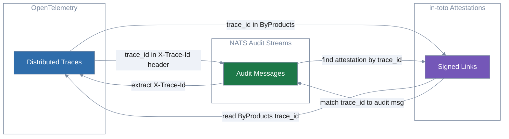

# Cryptographic Attestation

This document covers the in-toto attestation system for compliance audit trails, its integration with OpenTelemetry traces and NATS audit streams, and the current implementation status.

> **Status**: The `pkg/attestation` package is fully implemented. It provides in-toto attestation generation, verification (layouts, links, and hash chains), FIPS algorithm enforcement, enriched byproducts, and manifest generation, all backed by in-toto-golang v0.11.0 with automatic OTel trace correlation.

## Overview

CrossCodex uses [in-toto](https://in-toto.io/) attestations to provide cryptographic proof of every compliance-critical operation. An auditor should be able to verify that a compliance mapping was produced by a specific model, from specific input materials, at a specific time, and trace that attestation back to the full distributed trace of the operation.

Three systems work together:

1. **OpenTelemetry traces** record what happened and when (see [Telemetry](telemetry.md)).
2. **NATS audit streams** persist the operational record with integrity guarantees (see [Audit Streams](audit-streams.md)).
3. **in-toto attestations** provide cryptographic proof that each step was performed by an authorized process with the expected inputs and outputs.

The bridge between these systems is the OTel trace ID. Every attestation embeds the trace ID of the operation it attests to, and every audit message carries the same trace ID in its provenance headers. An auditor can start from any of the three systems and reach the other two.

## In-Toto Concepts

### Layouts

A layout defines the expected supply chain workflow — which steps should execute, in what order, and who is authorized to perform each step (called "functionaries" in in-toto terminology — the services or actors permitted to execute a given step). In CrossCodex, the Pipeline service signs the layout declaring the authorized stages and functionaries for a compliance processing run.

### Links

A link is an execution record for a single step. It captures:

- **Materials**: input artifacts with their SHA-256 digests (e.g., the OSCAL (Open Security Controls Assessment Language) catalog being analyzed)
- **Products**: output artifacts with their digests (e.g., the generated compliance mapping)
- **Command**: what was executed
- **By-products**: additional metadata, including the OTel trace ID, span ID, timestamp, and hostname

### Verification

Given a layout and a set of links, verification confirms that every declared step was performed by an authorized functionary, that the chain of materials-to-products is unbroken (hash chain verification), and that all signatures are valid.

## Package Structure

The `pkg/attestation` package defines the following:

### Generator Interface

```go
type Generator interface {
    CreateLayout(ctx context.Context, opts LayoutOptions) (*SignedLayout, error)
    CreateLink(ctx context.Context, step string, materials, products []Artifact, opts ...LinkOption) (*SignedLink, error)
    Verify(ctx context.Context, data []byte) (*VerifiedLink, error)
    VerifyLayout(ctx context.Context, data []byte) (*VerifiedLayout, error)
    VerifyChain(ctx context.Context, layout *SignedLayout, links []*SignedLink, subject Artifact) (*VerifiedChain, error)
}
```

`VerifyChain` verifies one run's whole attestation; see [Chain Verification](#chain-verification-verifychain).

### Key Providers

| Type                   | Purpose                                                                 |
|------------------------|-------------------------------------------------------------------------|
| `KeyProvider`          | Interface: `SigningKey`, `VerificationKey`, `KeyID` methods             |
| `FileKeyProvider`      | Reads ECDSA keys from PEM files on disk on every call                   |
| `LoadFileKeys`         | Reads a PEM key pair once, checks the halves match (and the curve in FIPS mode), and serves them from memory; the pipeline uses it |
| `EphemeralKeyProvider` | Generates in-memory ECDSA P-256 keys (tests)                            |

### Types

| Type             | Purpose                                                                    |
|------------------|----------------------------------------------------------------------------|
| `LayoutOptions`  | Layout creation parameters: steps, inspections, expiry duration            |
| `Step`           | Pipeline step with expected materials, products, command, and threshold    |
| `Inspection`     | Post-execution verification (run command, check success criteria)          |
| `Artifact`       | File or artifact with URI and SHA-256 digest                               |
| `SignedLayout`   | Signed layout envelope (raw bytes + expiry time)                           |
| `SignedLink`     | Signed link envelope (raw bytes, step name, trace ID, materials, products) |
| `VerifiedLayout` | Verified layout result (steps, inspections, expiry, key IDs)               |
| `VerifiedLink`   | Verified link result (step, materials, products, byproducts map)           |
| `LinkOption`     | Functional option for per-call link customization                          |

### Options

| Option                           | Purpose                                                         |
|----------------------------------|-----------------------------------------------------------------|
| `WithTelemetry(tracer, meter)`   | Enables OTel span emission and metrics recording                |
| `WithFIPSMode(enabled)`          | Enforces FIPS-approved algorithms (ECDSA P-256/384/521 only)    |
| `WithIncludeByProducts(enabled)` | Enriches links with span_id, timestamp, and hostname            |
| `WithByProducts(extra)`          | Per-call LinkOption to inject additional byproducts into a link |

### Errors

| Error                   | Meaning                                                  |
|-------------------------|----------------------------------------------------------|
| `ErrInvalidLayout`      | The layout is malformed or missing required fields       |
| `ErrSignatureFailed`    | Signing the attestation payload failed                   |
| `ErrVerificationFailed` | Signature verification did not pass                      |
| `ErrExpired`            | The layout has expired (VerifyLayout checks expiry)      |
| `ErrKeyNotFound`        | Key file not found at specified path                     |
| `ErrKeyLoadFailed`      | Key file exists but cannot be parsed                     |
| `ErrNonFIPSAlgorithm`   | Key uses non-FIPS algorithm (FIPS mode enforcement)      |
| `ErrChainBroken`        | A shared artifact's digests differ between two steps, or a link lacks an artifact its layout step expects |
| `ErrMissingLink`        | A layout step has no link                                |
| `ErrUnexpectedLink`     | A link for a step the layout does not declare, or a second link for a step |
| `ErrKeyMismatch`        | The public key file is not the private key's other half  |
| `ErrInvalidBundle`      | Data that is not an attestation bundle                   |

### Standalone Functions

| Function           | Purpose                                                         |
|--------------------|-----------------------------------------------------------------|
| `GenerateManifest` | Creates SHA-256 manifest in GNU coreutils format, sorted by URI |
| `MarshalBundle`    | Encodes a signed layout and its links as a bundle `{"layout": <envelope>, "links": [<envelope>, ...]}` |
| `ParseBundle`      | Decodes a bundle into its layout and links, unverified; rejects anything else, including a single envelope |

## Configuration

The `AttestationConfig` in `pkg/config` controls attestation behavior:

```yaml
attestation:
  enabled: true                    # Attest pipeline jobs (default true)
  private_key_path: /certs/attestation-key.pem   # SEC1 "EC PRIVATE KEY" PEM
  public_key_path: /certs/attestation-pub.pem    # PKIX "PUBLIC KEY" PEM of the same key
  expiry_duration: 8760h           # Layout expiry (default: 1 year)
  include_byproducts: true         # Add span_id, timestamp, hostname to links
  storage_retries: 3               # Retries of a failed attestation write, [0, 10]; global-only
  storage_retry_delay: 2s          # Wait before each retry, [0, 1m]; global-only
  tenant_overrides:                # Per-tenant overrides
    sensitive-tenant:
      enabled: true
      private_key_path: /certs/sensitive-key.pem   # Unset = inherit the global path
      public_key_path: /certs/sensitive-pub.pem
      expiry_duration: 4380h       # Shorter expiry for this tenant
      include_byproducts: false    # Strip environment metadata
```

The `ForTenant(tenantID)` method resolves per-tenant overrides with nil-pointer inheritance (an unset field inherits the global value; a field set to `""` is empty, not inherited) and returns an `AttestationTenantConfig` struct containing the resolved `Enabled`, `PrivateKeyPath`, `PublicKeyPath`, `ExpiryDuration`, and `IncludeByProducts` values.

Having one key path set but not the other is a validation error; per-tenant overrides follow the same pairing rule. Config loading accepts both empty, because the CLI and the non-pipeline roles load the same file and never sign. `AttestationConfig.RequireKeys` is the check for the roles that do: it reports, as a path-tagged `FieldError` wrapping `ErrMissingRequired`, each scope (the global settings or a tenant override) that enables attestation without both paths, saying to set them or set that scope's `enabled: false`. A tenant that only inherits the global problem is reported once, globally. There is no ephemeral-key mode: an attestation signed by a key nobody kept cannot be verified.

FIPS mode is not configured here: the pipeline passes `WithFIPSMode(tls.fips.enabled)` to its generators and `LoadFileKeys` checks the curve at startup.

## Attestation-Trace Bridge



Every attestation embeds the OTel trace ID from the active span context. The `CreateLink` method automatically injects `ByProducts["trace_id"]` via `telemetry.TraceIDFromContext(ctx)`. When `WithIncludeByProducts(true)` is set, additional metadata is included:

- `span_id` — current span ID via `telemetry.SpanIDFromContext(ctx)`
- `timestamp` — UTC time in RFC3339 format
- `hostname` — machine hostname via `os.Hostname()`

The proto field `AuditMetadata.correlation_id` (defined in `api/proto/crosscodex/v1/common.proto`) is documented as "OpenTelemetry trace ID" and serves the same bridging purpose at the protobuf layer.

## Verification Pipeline

### Layout Verification (`VerifyLayout`)

Deserializes a signed layout envelope, verifies the signature against the provider's verification key, checks expiry against the current time (returns `ErrExpired` if past), and returns a `VerifiedLayout` with the extracted steps, inspections, expiry time, and signer key IDs.

### Link Verification (`Verify`)

Deserializes a signed link envelope, verifies the signature, and returns a `VerifiedLink` with the step name, materials, products, and byproducts map (including trace_id).

### Chain Verification (`VerifyChain`)

`VerifyChain(ctx, layout, links, subject)` verifies one run's whole attestation, and that it is the attestation of `subject`, the run the caller expects. It returns the verified layout and the subject as the links record it (`*VerifiedChain`), or the first problem, naming the step and, for a chain error, the artifact URI:

1. `subject.URI` is set, every layout step expects it as a material, and every link records it with `subject.Digest`, or, when the caller passes no digest, all with one digest (`ErrSubjectMismatch`). A link or layout from another run is refused even when the same key signed it.
2. The layout is present (else `ErrInvalidLayout`), and `VerifyLayout` accepts it: valid signature, not expired.
3. Every link's signature verifies (`Verify`). Steps, materials and products are read from the verified envelopes; the caller's `SignedLink` fields other than `Raw` are ignored, and `links` is not modified. A link that fails verification is labelled with the step its payload claims.
4. Every layout step has exactly one link (`ErrMissingLink`), and no link is for an undeclared step or a step already linked (`ErrUnexpectedLink`).
5. Each link records every material and product its layout step expects (`ErrChainBroken`).
6. Wherever one step's material is another step's product, whatever their order in the layout, the digests match (`ErrChainBroken`).

Before #240 it compared only links adjacent in layout order, passed with zero or one link, did not require a link per step, trusted the caller's `SignedLink` fields, and bound nothing to a run.

`VerifyLayout`'s `KeyIDs` are the key IDs of the signatures that verified (the verifier's accepted keys), not every signature entry in the envelope, which may carry bogus ones.

### FIPS Mode (`WithFIPSMode`)

When enabled, validates that all signing keys use FIPS-approved algorithms (ECDSA with P-256, P-384, or P-521 curves). Non-ECDSA keys or unsupported curves are rejected with `ErrNonFIPSAlgorithm`. The check runs at both `CreateLayout` and `CreateLink` time.

## Storage Paths

The pipeline stores each attested job's objects under `attestations/<tenant>/<job-id>/`:

- `layout.json`: the signed layout.
- `links/<step>.json`: one signed link per layout step.
- `bundle.json`: the layout and every link (`MarshalBundle`), written once the chain verifies.

`storage.JobAttestationKey` and `storage.ContentKey` below are general key helpers; the pipeline does not use them.

Attestation artifacts can also be stored at two complementary path types:

### Job-Structured Paths (Discoverability)

`storage.JobAttestationKey(jobID, filename)` generates paths like:
- `jobs/<jobID>/attestation/layout.json`
- `jobs/<jobID>/attestation/<step>.link.json`
- `jobs/<jobID>/attestation/input_manifest.sha256`

### Content-Addressed Paths (Integrity)

`storage.ContentKey(data)` generates paths like:
- `attestation/<sha256-hash>.json`

Both paths store the same artifact. Job-structured paths enable browsing by job; content-addressed paths enable integrity verification (the key itself proves the content hasn't been modified).

Tenant prefixing is handled by the storage `Provider` layer, not by the key generation functions.

## DAG-to-Layout Bridge

The `internal/pipeline/attestation` package provides a `Converter` that transforms an `analyzer.DAG` into `attestation.LayoutOptions`:

- Each analyzer becomes a `Step`
- `Step.Name` = analyzer name
- `Step.ExpectedMaterials` = product names of dependencies (`<dep>.output`)
- `Step.ExpectedProducts` = `[<name>.output]`
- `Step.Threshold` = 1 (single signer per step)
- Steps are ordered by DAG topological order
- `ExpiresIn` is NOT set by the converter — the caller wires it from `AttestationConfig.ExpiryDuration`

The pipeline also adds `<name>.cache_manifest` to every analyzer step's expected materials (`createLayout`). Each analyzer link records that material and the result-cache byproducts `result_cache.mode`, `result_cache.reason` and `result_cache.attempt` (`attestAnalyzers`, `internal/pipeline/attest_cache.go`):

- The material is the `resultcache.Manifest` digest that the signed cache checkpoint of the attempt that completed the stage signs (the digest of the checkpoint's product), not a digest of the checkpoint file.
- For a stage that kept no cache records, the material is the empty manifest's digest.

Cache checkpoints are separate in-toto links with step `result-cache-checkpoint`, stored under `attestations/<tenant>/<job>/cache-checkpoints/`. They are not part of the job's chain. See [LLM Result Reuse](design-principles.md#llm-result-reuse).

### Recomputing a cache manifest digest

An auditor can recompute the digest from the attempt's rows without the Go code (`resultcache.Manifest.Digest`, `pkg/resultcache/resultcache.go`). The rows are the attempt's `job_cache_entries` and `job_cache_stats` rows, selected by tenant, job, analyzer and attempt.

1. **Build one JSON object, with no whitespace between tokens and these keys in this order:**

   ```json
   {"tenant_id":"…","job_id":"…","analyzer":"…","attempt":"…","entries":[…],"stats":[…]}
   ```

2. **`entries`.** Every entry row, as an object with these keys in this order:

   ```json
   {"task_id":"…","role":"…","cache_key":"…","result_digest":"…","producer_job_id":"…"}
   ```

   - `role` is `hit` or `write`.
   - `producer_job_id` is `""` for a write.
   - Sort the entries by `task_id`, then `role`, `cache_key`, `result_digest` and `producer_job_id`. Each comparison is byte-wise on the UTF-8 strings (`resultcache.CompareEntries`).
   - No entries is `[]`, never `null`.
3. **`stats`.** Every stats row, oldest first (in recorded order, `job_cache_stats.seq`), as an object with these keys in this order:

   ```json
   {"mode":"…","reason":"…","models":{…},"tasks":N,"hits":N,"dispatched":N}
   ```

   - `models` maps each alias to `{"observed":"…","revision":"…"}`, with its keys sorted byte-wise.
   - No models is `{}`, never `null`.
   - The counts are decimal integers.
   - No stats rows is `[]`.
4. **Strings** use Go's `encoding/json` escaping: `"` and `\` are backslash-escaped, control characters become `\u00XX` (or `\n`, `\r`, `\t`), and `<`, `>`, `&`, U+2028 and U+2029 become `\u003c`, `\u003e`, `\u0026`, `\u2028` and `\u2029`. Invalid UTF-8 bytes become `\ufffd`.
5. **The digest** is `sha256:` followed by the lowercase hex SHA-256 of those bytes. A stage that kept no records pins the digest of `{"tenant_id":"","job_id":"","analyzer":"","attempt":"","entries":[],"stats":[]}`.

This adapter keeps `pkg/attestation` and `pkg/analyzer` decoupled. The pipeline appends its own steps to the converter's: `synthesis` (expects every analyzer's `<name>.output`, produces `synthesis.output`) and `graph` (expects `synthesis.output`). Only enabled analyzers are in the DAG, so a disabled analyzer has no step and needs no link. `candidate_generation` is not a step and has no link: its output reaches the chain through the analyzers that read the candidates.

## Pipeline Attestation (Fail Closed)

`internal/pipeline` attests a job only when its tenant resolves to an `Attestor` (`Attestors.forTenant`): `attestation.enabled`, overridden per tenant by `attestation.tenant_overrides`. `pipeline.NewAttestors` builds them at startup and fails closed: it runs `RequireKeys`, loads each distinct key pair once with `LoadFileKeys` (FIPS mode from `tls.fips.enabled`), and builds one generator per scope with its `include_byproducts` and `expiry_duration`. Roles `all` and `pipeline` refuse to start on any error. A disabled scope gets no `Attestor`, no key is read for it, and `crosscodexd` logs at startup which scopes are unattested.

Every layout step expects, and every link records, the job's subject: `job:<tenant>/<job-id>` with the SHA-256 of the job's config as stored (`jobs.config`). Finalization passes it to `VerifyChain`, and a stored link that records another job is refused, so a link or bundle cannot be replayed into another job, even within a tenant that shares the global key.

An attested job completes only once its whole attestation is stored. In order:

0. **Stored links first**: a resumed job reads back and verifies the stored links of the synthesis and graph stages an earlier run completed, before it signs or stores anything. A missing or unverifiable one (modified, signed with another key pair, or for another job) fails the job with every stored object as it was.
1. **Layout**: signed and stored after the analyzer check and before any analyzer runs. A failure fails the job with no analyzer run.
2. **Analyzer links**: after analysis, one link per DAG analyzer. The digests are SHA-256 of each analyzer's result as stored (`analysis_results.result_data`, what synthesis reads), so a resumed run signs the same digests and an analyzer link can always be made again from the database. Links are re-signed on every run, including a resume.
3. **Synthesis and graph links**: signed and stored before the stage is marked completed. A failure fails the stage and the job. A resumed job does not run a completed synthesis or graph stage again; step 0 read its link back. The synthesis product digest is SHA-256 of the JSON encoding of the result synthesis returned (rows, quality report, content hash), not of rows read back from the database: synthesis persists its output across several tables (viability on `vote_summaries`, among others) with no canonical encoding an auditor could recompute, so binding the link to a database query is left for a change that defines one.
4. **Finalization**: `VerifyChain` over the layout and every link, then the bundle is stored, then published to the audit trail. A chain that does not verify or a bundle that is not stored fails the job; the audit publish is best effort, because the stored bundle is the record.

Failures are classified with sentinels in `internal/pipeline/errors.go`, and each message names the job, the step and the object key and says what to do:

| Sentinel | Cause | Recovery |
|---|---|---|
| `ErrAttestationSigning` | The layout, a link or the bundle could not be signed or encoded | Fix the key pair and restart `crosscodexd`, then retry or start a new job |
| `ErrAttestationStorage` | Object storage refused a write after `storage_retries` retries `storage_retry_delay` apart (at most 10m of retry delay per write), or a stored link could not be read | Transient: fix storage, then `crosscodex run retry --from-failure <job-id>`, or start a new job |
| `ErrAttestationInvalid` | A stored link is missing or does not verify, an analyzer has no stored result, or the chain does not verify | Permanent: start a new job |

Retries happen in process, within the job's context, so a cancel or shutdown stops them. `crosscodex run retry --from-failure` (gateway `RetryJob`, then the pipeline's) resumes a failed or cancelled job whose stages did not fail, which is where a layout, analyzer-link, or bundle failure leaves it; it resets no stage, so a job whose bundle was not stored only finalizes again.

`RetryJob` refuses, with `FailedPrecondition` and the job left unchanged, a job whose failure a retry cannot fix. The class is decided by sentinel when the job fails (`pipeline.ClassifyJobError`: `ErrAttestationInvalid`, `ErrAnalyzersChanged`, `ErrMissingCatalogID`) and stored in `jobs.error_class`, because the stored message is text and must not be matched.

## Operations Requiring Attestations

Four categories of compliance-critical operations must generate attestations when the services are implemented:

| Operation         | Service              | What the Attestation Proves                                    |
|-------------------|----------------------|----------------------------------------------------------------|
| Catalog ingestion | Ingestion Service    | OSCAL document authenticity, validation result, source hash    |
| Control mappings  | Analysis / Synthesis | AI-generated mapping accuracy, model used, input/output hashes |
| Risk assessments  | Analysis Service     | Evaluation results, evidence collected, criteria applied       |
| Policy violations | (enforcement)        | Actions taken, audit trail, affected controls                  |

## Reading Attestations

An auditor verifying a compliance determination would:

1. Find the compliance decision in the `AUDIT_DECISIONS` NATS stream.
2. Extract the `X-Trace-Id` provenance header to get the trace ID.
3. Find the job's bundle in object storage at `attestations/<tenant>/<job-id>/bundle.json`; each link's byproducts carry the trace ID.
4. Verify the bundle: `crosscodex results verify bundle.json --public-key <attestation public key> --tenant <tenant> --job-id <job-id>` runs `ParseBundle` and `VerifyChain` with subject `job:<tenant>/<job-id>`, which covers the binding to that job, the layout signature and expiry, every link signature, one link per step and the hash chain, and prints the config digest the links record; compare it with the SHA-256 of the job's `jobs.config`. It reads only the file, not the database.
5. Optionally, view the full trace in Jaeger using the same trace ID to see timing, service interactions, and error details.

## Remaining Work

- **Service implementations**: The internal services (`internal/ingestion`, `internal/catalog`, `internal/analysis`, `internal/synthesis`) that would call the attestation API.
- **`AuditMetadata.correlation_id` population**: Each service must set this field from `telemetry.TraceIDFromContext(ctx)` when constructing protobuf messages.
- **Bundle retrieval by job ID**: `crosscodex results verify` verifies a bundle file copied out of object storage. No RPC exposes attestation objects, so fetching a job's bundle through the gateway needs a new tenant-scoped RPC.
- **Gateway attestations**: `gateway.WithAttestor` is not wired by `crosscodexd`, and `emitAttestation` discards the link it creates.

## Security Considerations

- Attestation signing keys must be protected. Use `pkg/tlsconfig/pki` (or `task deploy:certs`) for key generation in development and a proper key management system (HSM, Vault) in production. The `EphemeralKeyProvider` is for tests only.
- Rotating the key pair invalidates the stored synthesis and graph links of jobs still running: on resume they no longer verify and the job fails. Rotate between jobs, and keep old public keys to verify old bundles.
- When `WithFIPSMode(true)` is set, only ECDSA P-256/384/521 keys are accepted. This is enforced at signing time, not just configuration time.
- The attestation chain depends on the integrity of the OTel trace ID. If trace context is dropped or spoofed, the link between the attestation and the operational record is broken. TLS transport encryption and provenance header validation (enforced by `pkg/natsbus`) mitigate this.
- Layouts define who is authorized to perform each step. A compromised signing key allows unauthorized attestations. Key rotation and revocation procedures should be defined before production deployment.
- Attestation bundles stored in object storage are content-addressed (keyed by hash), making them immutable. Deleting an attestation requires deleting the storage object, which should be restricted to platform administrators.
